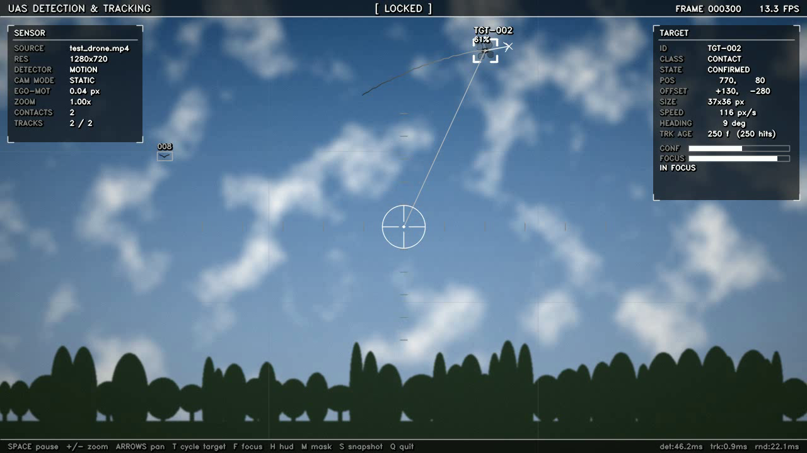
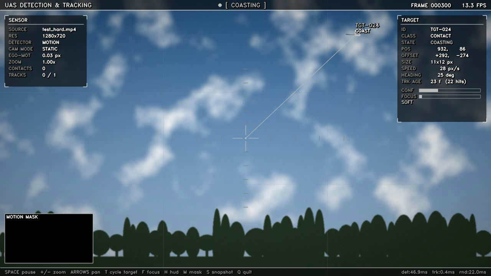
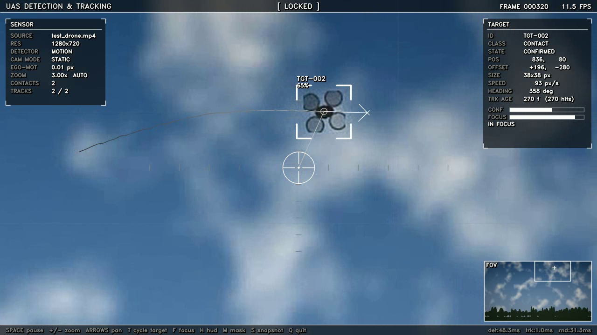

# UAS Detection & Tracking System

Detection and tracking of small airborne objects (UAS / drones) in video, with
an operator HUD: reticle, target brackets, digital zoom, focus measurement and
telemetry panels.

Stage 1 runs: analysis of MP4 files. Live camera (`--source 0`) is prepared,
gimbal actuation is the next step.

   

It needs no model weights and no GPU to be useful. The default backend is
motion-based, because a drone at range is a handful of pixels with almost no
texture — exactly where appearance-based detectors are weakest and where
*"it moves differently from the sky behind it"* is the strongest available cue.



---

## Quick start

```bash
pip install -r requirements.txt
```

Generate a synthetic test clip with ground truth — no drone footage required:

```bash
python tools/make_test_video.py --out output/test_drone.mp4
```

Run the operator display:

```bash
python -m src.main --source output/test_drone.mp4
```

Headless, writing an annotated video and a per-frame track log:

```bash
python -m src.main --source clip.mp4 --no-display --record output/annotated.mp4 --export-tracks output/tracks.jsonl
```

Score the result against ground truth:

```bash
python tools/evaluate.py --tracks output/tracks.jsonl --ground-truth output/test_drone_groundtruth.json
```

Tune any parameter without editing files:

```bash
python -m src.main --source clip.mp4 --set detection.motion.min_area=30
```

### Controls

`SPACE` pause · `n` step while paused · `+`/`-` zoom · arrows pan · `0` reset
zoom · `t` cycle target · `y` release manual lock · `f` focus assist · `h` HUD ·
`m` motion mask · `g` grid · `d` raw detections · `a` auto-follow · `s` snapshot ·
`q` quit.

---

## What it shows

Raw detections and the motion mask, for tuning and for understanding what the
detector actually sees rather than what the tracker reports:



Digital zoom with focus assist. Zoom is **display only** — detection and
tracking always consume the untouched source frame, so an operator aid can never
change what the system believes it sees:



---

## Measured results

Against `tools/make_test_video.py` ground truth, 35-frame warm-up excluded:

| Scenario | Recall | Precision | F1 | Mean IoU | ID switches |
|---|---|---|---|---|---|
| Static camera, 600 frames | 99.6 % | 91.6 % | 95.5 % | 0.520 | 2 |
| Panning camera, 360 frames | 100 % | 79.1 % | 88.3 % | 0.473 | 1 |
| **Hard**: 8–14 px, defocused, hazy | 80.4 % | 96.3 % | 87.7 % | 0.381 | 7 |

Reproduce all three:

```bash
python tools/bench_synthetic.py
```

The hard case is the limit of the method: 8–14 px targets at roughly **4 grey
levels of contrast against a noise sigma of 3**. Before the small-target work it
scored 59.1 % recall with 135 frames of acquisition latency.

Measuring before and after a change is not optional here — several
plausible-sounding improvements made the numbers measurably worse, and they are
recorded as dead ends in [`docs/FINDINGS.md`](docs/FINDINGS.md) so nobody
re-attempts them.

### On real footage

The system was also measured on three real clips: a handheld urban pan
containing **no airborne target at all** (so every contact is provably false), a
night CCTV clip with a bright point target, and a chase camera following an
aerobatic model aircraft. That work changed several defaults and uncovered three
bugs that three synthetic scenarios had never exposed.

The headline: **recall on real footage was never the problem** (90 %, 93 %).
Precision was — 161 false tracks per minute on a clip with an empty sky, cut to
65 by the fixes in [`docs/FINDINGS.md`](docs/FINDINGS.md).

> **Those clips are not in this repository** (large, and not redistributable).
> `tools/bench_real.py` reports each scenario as missing until you supply your
> own footage under `video/`. Label it with `tools/label_real.py` and add it to
> `SCENARIOS`. Numbers measured on different footage are not comparable to the
> ones recorded in the docs.

---

## Architecture

```
src/
├── main.py              CLI entry point; flag to config resolution
├── pipeline.py          frame loop; owns ORDER of operations only
├── detection/
│   ├── base.py          Detection dataclass + Detector ABC  <- the data contract
│   ├── motion.py        MOG2 / ego-motion-compensated differencing
│   ├── small_target.py  sensitive path for small dim targets
│   ├── cnn.py           optional YOLO backend (degrades gracefully if absent)
│   └── fusion.py        evidence combination across backends
├── tracking/
│   ├── kalman.py        8-state constant-velocity filter
│   ├── track.py         Track + lifecycle state machine
│   └── tracker.py       Hungarian association + primary-target selection
├── control/
│   └── gimbal.py        Stage 3: PID pan/tilt over serial
├── ui/                  HUD, viewport, focus, themes
└── utils/               config, geometry, video I/O, timing

firmware/gimbal/         ESP32 pan/tilt firmware
tools/                   clip generator, labelling, evaluation, benchmarks
config/                  every tunable, with a comment on what it trades off
```

### Invariants

1. **Detection and tracking consume the untouched source frame.** Zoom and focus
   assist are display only.
2. **All detection and tracking geometry is in source-pixel coordinates.** The
   HUD converts to screen space; drawing track geometry without mapping it makes
   overlays drift when zoomed.
3. **`pipeline.py` contains no algorithms.** It owns sequencing. New capability
   goes in `detection/`, `tracking/`, `control/` or `ui/`.
4. **New detectors implement `Detector.detect()` and return `Detection`.**
   Nothing downstream needs changing.

---

## Hardware (Stage 3)

`firmware/gimbal/gimbal.ino` drives an ESP32 with two servos over a line
protocol at 115200 baud:

```
"<pan>,<tilt>,<laser>\n"
```

with pan and tilt in `[-1000, 1000]`, a 1 s failsafe that re-centres the servos
if commands stop arriving, and software limits on the tilt axis. The failsafe
lives on the device deliberately: a crash, an unplugged cable or a hung host
process must not leave the servos driving.

The host side is `src/control/gimbal.py`, which turns the primary target's
offset from frame centre into pan/tilt commands through a PID loop. It needs
`pyserial`, which is an optional dependency.

**The laser output is deliberately not wired.** The protocol carries the field
because the original firmware did; the firmware answers `ERR LASER_NOT_WIRED` to
any non-zero value. This is a legal question rather than a technical one —
directing a laser at aircraft is a criminal offence in Germany (§ 315 StGB and
Luftverkehrsgesetz provisions), and a tracker that is slightly off, or that
locks onto a manned aircraft instead of the intended drone, points it somewhere
nobody chose. The defensible build drives the camera and logs the track.

---

## Known limitations

* **The stock CNN backend is not a drone detector.** COCO has no UAS class, so
  `airplane`/`bird`/`kite` stand in as generic airborne contacts to make the
  plumbing testable. `tools/fetch_weights.py` registers two MIT-licensed
  purpose-trained drone models; expect them to do well on near drones and poorly
  on the 10–20 px distant case this project exists for, which is why the
  recommended backend is `fusion`.
* **No drone/bird discrimination.** The motion detector reports that *something*
  is moving up there. Telling a quadcopter from a bird is far easier from a
  *track* than a frame — birds flap and turn erratically, multirotors hold
  straight legs and hover — and the features are already on `Track`.
* **"Focus" is measurement and display assist, not autofocus.** There is no lens
  motor to drive.
* **Everything is in pixels.** Ranges, altitudes and real-world speeds need
  camera intrinsics plus either a known target size or a second sensor.
* **No real UAS has ever been in the test footage.** A model aeroplane and an
  unidentified light are not a quadcopter. The multirotor signature — hovering,
  abrupt direction changes — is the least tested case of all. Get real drone
  footage before trusting any of this.

---

## License

MIT
